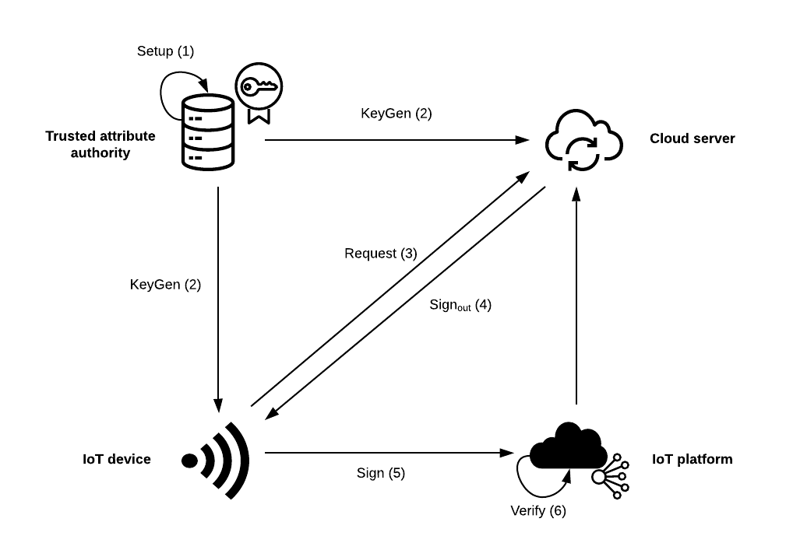
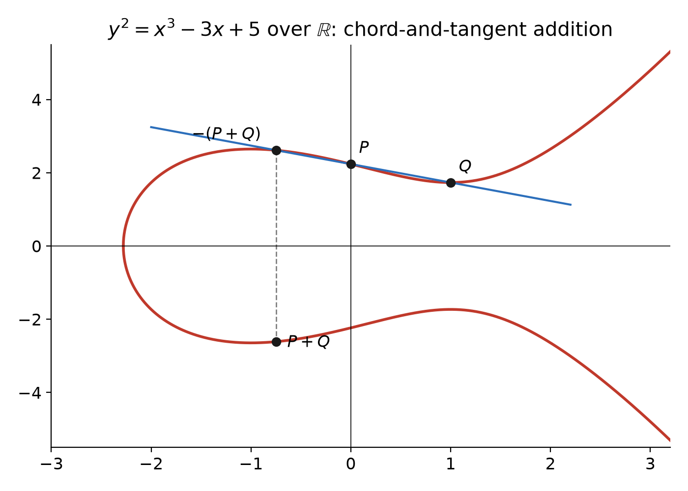
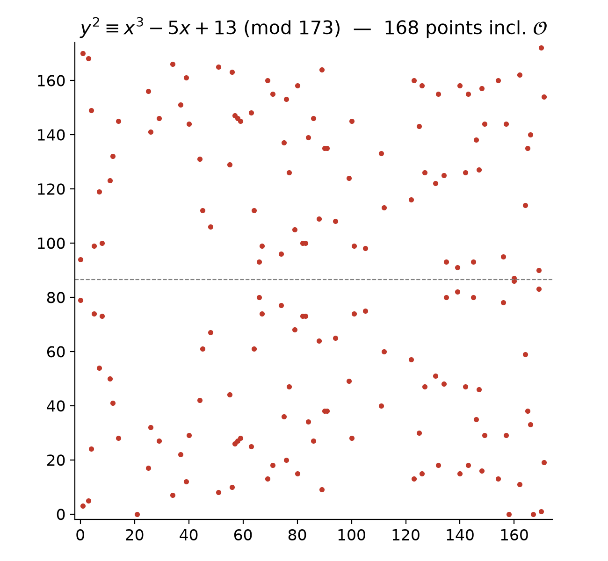
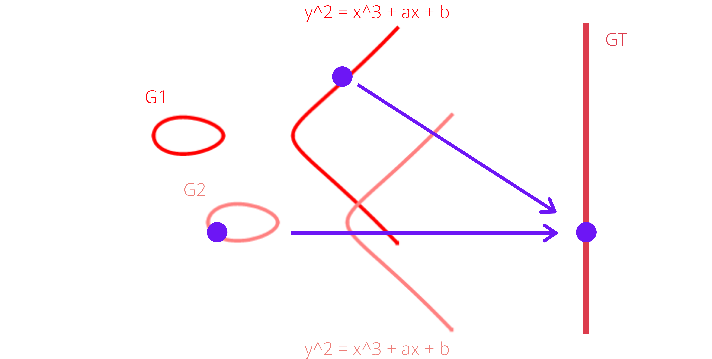
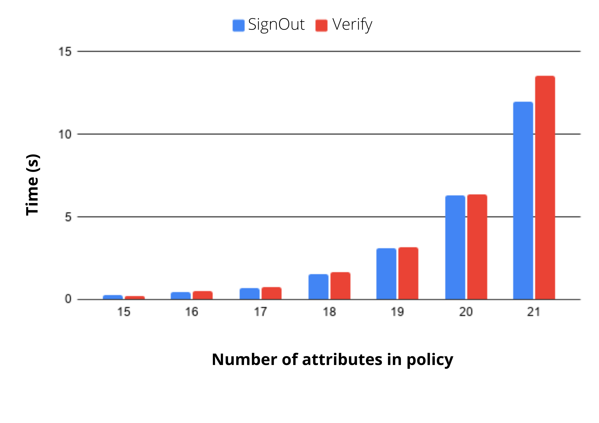

# Cloud-Assisted-Access-Control-for-IoT

CHARIOT (Cloud-Assisted Access Control for the Internet of Things) is a policy-based access control protocol suitable for an IoT environment.
Computationally intensive signature generation is offloaded from the IoT device to an untrusted, powerful cloud server. This is vital since IoT devices are severely constrained in memory and computational power.

This repository contains a prototype implementation of CHARIOT for the purposes of testing, benchmarking, and ultimately validating the protocol.

CHARIOT uses elliptic curve bilinear pairings, a threshold attribute-based signature (ABS) scheme, and Groth–Sahai non-interactive zero-knowledge proofs.

- Original paper: [CHARIOT: Cloud-Assisted Access Control for the Internet of Things](https://www.researchgate.net/publication/329061206_CHARIOT_Cloud-Assisted_Access_Control_for_the_Internet_of_Things) (Gritti, Önen, Molva, PST 2018)
- My Honours report: [CHARIOT-report.pdf](https://github.com/Viktor-Bubanja/Cloud-Assisted-Access-Control-for-IoT/files/7071798/CHARIOT-report.pdf)

## Contents

1. [Protocol overview](#protocol-overview)
2. [Mathematical background](#mathematical-background)
3. [The construction](#the-construction)
4. [Implementation notes](#implementation-notes)
5. [Complexity analysis](#complexity-analysis)
6. [Benchmarks](#benchmarks)
7. [Testing and debugging via pairing equalities](#testing-and-debugging-via-pairing-equalities)
8. [Installation](#installation) · [Running](#running) · [Parameters](#parameters)

---

## Protocol overview

An IoT device must prove to an IoT platform that it holds **at least $`t`$ of the $`s`$ attributes** named in a threshold policy $`(t, S)`$, without revealing *which* attributes it holds. Producing that proof is expensive, so most of the work is done by a cloud server that is **not trusted**. The server works only on keyed hashes of the attributes and never holds the final secret needed to finish the signature.

<p align="center">
  
  <br><em>Figure 1 – The four CHARIOT entities and the six algorithms run between them.</em>
</p>

| # | Algorithm | Run by | Purpose |
|---|-----------|--------|---------|
| 1 | `Setup`   | Trusted attribute authority | Generate public parameters and master secret key $`\mathsf{msk} = (\alpha, \beta, \gamma)`$ |
| 2 | `KeyGen`  | Trusted attribute authority | Issue an outsourcing key to the cloud, a private key to the device, and a verification key to the platform |
| 3 | `Request` | IoT device | Hash the policy attributes with an HMAC so the cloud never sees them in the clear |
| 4 | `SignOut` | Cloud server | Do the heavy pairing-based signature work |
| 5 | `Sign`    | IoT device | Finish the signature with a single secret group element (cheap) |
| 6 | `Verify`  | IoT platform | Accept or reject the device |

---

## Mathematical background

### Groups and fields

A **group** $`(G, \oplus)`$ is a set with an associative binary operation that has an identity element and an inverse for every element. It is **abelian** if $`a \oplus b = b \oplus a`$ for all $`a, b`$. A **field** $`(F, \oplus, \odot)`$ is a set with two commutative, associative operations, each with an identity and with inverses (except for the multiplicative inverse of $`0`$), where $`\odot`$ distributes over $`\oplus`$.

CHARIOT computes in two kinds of structure at the same time:

- a cyclic **group** $`\mathbb{G}`$ of prime order $`p`$ (points on an elliptic curve), and
- the **scalar field** $`\mathbb{Z}_p`$, where exponents live and arithmetic is done modulo $`p`$.

Keeping these two apart is the main difficulty in implementing the protocol (see [Implementation notes](#implementation-notes)).

### Elliptic curves over $`\mathbb{R}`$

An elliptic curve in short Weierstrass form is

```math
E:\; y^2 = x^3 + ax + b, \qquad \Delta = -16\,(4a^3 + 27b^2) \neq 0 .
```

The condition $`\Delta \neq 0`$ makes the curve smooth (no cusps or self-intersections). When $`\Delta < 0`$ the real graph has one component, and when $`\Delta > 0`$ it has two. The points of $`E`$, together with a point at infinity $`\mathcal{O}`$, form an **abelian group** with $`\mathcal{O}`$ as the identity. To add $`P`$ and $`Q`$, draw the line through them, find the third point where it meets the curve, and reflect that point across the $`x`$-axis:

<p align="center">
  
  <br><em>Figure 2 – Point addition on <code>y² = x³ − 3x + 5</code>. Here Δ = −16·567 < 0, so the curve has a single real component.</em>
</p>

Algebraically, with $`R = P + Q`$:

```math
\lambda =
\begin{cases}
\dfrac{y_Q - y_P}{x_Q - x_P}, & P \neq Q \quad\text{(chord)}\\[2ex]
\dfrac{3x_P^2 + a}{2y_P}, & P = Q \quad\text{(tangent)}
\end{cases}
\qquad
\begin{aligned}
x_R &= \lambda^2 - x_P - x_Q\\
y_R &= \lambda\,(x_P - x_R) - y_P
\end{aligned}
```

Scalar multiplication $`nP = P + \dots + P`$ (written $`P^n`$ in multiplicative notation, as in the rest of this README) takes $`O(\log n)`$ group operations with double-and-add.

### Elliptic curves over finite fields

For cryptography the curve is defined over a Galois field $`GF(p)`$:

```math
E(GF(p)) = \{(x,y) \in GF(p)^2 \;:\; y^2 \equiv x^3 + ax + b \pmod p\} \cup \{\mathcal{O}\}, \qquad 4a^3 + 27b^2 \not\equiv 0 \pmod p .
```

The formulas above still hold, with division $`x / y`$ read as $`x \cdot y^{-1} \bmod p`$. The smooth curve becomes a scattered set of points, symmetric about $`y = p/2`$ because $`(x, y) \in E \Rightarrow (x, p - y) \in E`$:

<p align="center">
  
  <br><em>Figure 3 – <code>y² ≡ x³ − 5x + 13 (mod 173)</code>. Its 168 points satisfy Hasse's bound |#E − (p+1)| = 6 ≤ 2√173 ≈ 26.3.</em>
</p>

Security rests on the **elliptic curve discrete logarithm problem (ECDLP)**: given $`P`$ and $`Q = P^n`$, find $`n`$. Computing $`P^n`$ costs $`O(\log n)`$, but no known classical algorithm inverts it in polynomial time. The best generic attacks need about $`\sqrt{p}`$ operations, compared with the sub-exponential number field sieve that breaks RSA. As a result, a 224-bit ECC key gives roughly the same security as a 2048-bit RSA modulus, which matters on memory-constrained IoT hardware.

### Bilinear pairings

A **pairing** is a map $`e : \mathbb{G}_1 \times \mathbb{G}_2 \to \mathbb{G}_T`$ between groups of prime order $`p`$ that is:

```math
\begin{aligned}
&\textbf{bilinear:} && e\!\left(g_1^{a},\, g_2^{b}\right) = e(g_1, g_2)^{ab} \quad \forall a, b \in \mathbb{Z}_p,\\
&\textbf{non-degenerate:} && e(g_1, g_2) \text{ generates } \mathbb{G}_T,\\
&\textbf{efficiently computable.}
\end{aligned}
```

<p align="center">
  
  <br><em>Figure 4 – A pairing takes one point from each source group to an element of the target group G<sub>T</sub>.</em>
</p>

CHARIOT uses a **symmetric** (Type 1) pairing, where $`\mathbb{G}_1 = \mathbb{G}_2 = \mathbb{G}`$. This gives the extra identity $`e(g, h) = e(h, g)`$, which the correctness proof below depends on. The Charm curves `SS512`/`SS1024` are supersingular curves with embedding degree 2, so $`\mathbb{G}_T`$ is a subgroup of $`\mathbb{F}_{q^2}^{*}`$ (where $`q`$ is the curve's base field), not a group of curve points. Because the pairing moves discrete logarithms from $`\mathbb{G}`$ into $`\mathbb{F}_{q^2}^{*}`$ (the MOV reduction), these curves need much larger base fields than ordinary ECC curves.

### Hash functions

| Symbol | Role | Choice |
|--------|------|--------|
| $`H : \{0,1\}^* \to \{0,1\}^k`$ | Hashes the message $`M`$ to $`k`$ bits, which select the Groth–Sahai CRS vector | BLAKE2b with variable digest length (faster than SHAKE128/256) |
| $`\tau(K, \cdot)`$ | Keyed hash of attributes into $`\mathbb{Z}_p`$, so the cloud only sees pseudorandom values | HMAC-SHA-256, read as an integer and reduced into $`\mathbb{Z}_p`$ |

---

## The construction

Throughout, $`\Omega`$ is the device's attribute set ($`|\Omega| = \omega`$), $`S`$ is the policy ($`|S| = s`$), $`t`$ is the threshold, and $`n`$ is the upper bound on policy size. For any attribute set $`A`$ define the polynomial

```math
F_A(X) \;=\; \prod_{at \in A} \bigl(X + \tau(K, at)\bigr) \in \mathbb{Z}_p[X].
```

Everything below relies on one fact: if $`\Omega_S \subseteq S`$, then $`F_S = F_{\Omega_S} \cdot F_{S \setminus \Omega_S}`$.

### Setup

Choose generators $`g, h \in \mathbb{G}`$ and $`\alpha, \beta, \gamma \in_R \mathbb{Z}_p^*`$, and publish

```math
u = g^{\beta}, \qquad
v_i = g^{\alpha / \gamma^{i}}, \qquad
h_i = h^{\alpha \gamma^{i}} \qquad (i = 0, \dots, n),
```

together with the Groth–Sahai (DLIN) commitment key $`\vec g_1 = (g_1, 1, g)`$, $`\vec g_2 = (1, g_2, g)`$ and $`\vec g_{3,i} = (g_1^{\xi_{i,1}}, g_2^{\xi_{i,2}}, g^{\xi_{i,1}+\xi_{i,2}})`$ for $`i \in [0, k]`$.

Because the $`h_i`$ encode the powers $`\alpha\gamma^i`$ in the exponent, anyone can compute $`h^{\alpha P(\gamma)}`$ for any public polynomial $`P`$ of degree at most $`n`$ without knowing $`\alpha`$ or $`\gamma`$:

```math
H_S \;=\; h^{\alpha F_S(\gamma)} \;=\; \prod_{i=0}^{s} h_i^{\,c_i}, \qquad\text{where } F_S(X) = \sum_{i=0}^{s} c_i X^i .
```

### KeyGen

Choose $`\beta_1, r \in_R \mathbb{Z}_p`$ and set $`\beta_2 = \beta + \beta_1`$. The authority hands out:

```math
\begin{aligned}
\mathsf{osk}_{\text{cloud}} &= \Bigl(\{g^{\,r/(\gamma + \tau(K,at))}\}_{at \in \Omega},\; g^{\beta_1},\; \{h^{r\gamma^{i}}\}_{i=1}^{n-1},\; h^{(r-\beta_2)\gamma^{n}}\Bigr)\\
\mathsf{sk}_{\text{device}} &= \bigl(h^{\beta_1 \gamma^{n}},\; K\bigr), \qquad \mathsf{sk}_{\text{platform}} = K
\end{aligned}
```

The cloud's key is missing the $`\beta_1`$ term, so the cloud **cannot produce a valid signature on its own**. The device adds that term back with a single group multiplication.

### SignOut (cloud)

The cloud picks $`\Omega_S \subseteq \Omega \cap S`$ with $`|\Omega_S| = t`$ and combines the $`t`$ key components into one using `Aggregate` (Delerablée–Paillier–Pointcheval). This relies on the partial-fraction identity

```math
\frac{1}{(\gamma + x_j)(\gamma + x_l)} = \frac{1}{x_l - x_j}\left(\frac{1}{\gamma + x_j} - \frac{1}{\gamma + x_l}\right),
```

applied repeatedly in the exponent, which gives

```math
T_1 = g^{\,r / F_{\Omega_S}(\gamma)} .
```

With $`F_{S\setminus\Omega_S}(X) = \sum_{i=0}^{s-t} b_i X^i`$ (and $`b_{s-t}=1`$), the cloud also computes

```math
T_2' \;=\; h^{(r-\beta_2)\gamma^{n}} \prod_{i=0}^{s-t-1} \bigl(h^{r\gamma^{\,i+n-s+t}}\bigr)^{b_i}
\;=\; h^{\gamma^{\,n-s+t}\left(r F_{S\setminus\Omega_S}(\gamma) \;-\; \beta_2 \gamma^{s-t}\right)} ,
```

checks its own work with

```math
e\!\left(T_1, H_S\right) \;=\; e\!\left(u \cdot g^{\beta_1},\, h_{s-t}\right)\cdot e\!\left(T_2',\, v_{n-s+t}\right),
```

and returns Groth–Sahai commitments to $`T_1`$, $`T_2'`$ and $`\theta = h_{s-t}`$, along with partial proof elements.

### Sign (device)

The device sets $`T_2 = T_2' \cdot h^{\beta_1\gamma^n}`$, which turns $`\beta_2`$ into $`\beta`$ in the exponent. It then re-randomises every commitment with a message-dependent CRS vector:

```math
\vec g_{3,m} \;=\; \vec g_{3,0} \odot \prod_{i=1}^{k} \vec g_{3,i}^{\,m_i}, \qquad m = H(M) \in \{0,1\}^k,
\qquad
\vec C_X \;=\; (1, 1, X) \odot \vec g_1^{\,r_X} \odot \vec g_2^{\,s_X} \odot \vec g_{3,m}^{\,t_X}.
```

The signing work itself is a handful of exponentiations that grows linearly in $`k`$. The prototype also has the device check the cloud's output against the equation below before signing, which takes three pairings.

### Verify (platform)

Underneath, the platform checks the pairing-product equation

```math
\boxed{\; e\!\left(T_1, H_S\right) \;=\; e\!\left(u,\, h_{s-t}\right)\cdot e\!\left(T_2,\, v_{n-s+t}\right) \;}
```

However, it only ever sees *commitments* to $`T_1, T_2, \theta`$, so it learns nothing about which attributes were used. It checks the equation through the Groth–Sahai proof $`(\vec\pi_1, \vec\pi_2)`$, one coordinate $`j \in \{1,2,3\}`$ at a time:

```math
\begin{aligned}
e(H_S, C_{T_1,j}) &= e(u, C_{\theta,j})\, e(v_{n-s+t}, C_{T_2,j})\, e(\pi_{1,1}, g_{1,j})\, e(\pi_{1,2}, g_{2,j})\, e(\pi_{1,3}, g_{3,m,j}),\\
e(g, C_{\theta,j}) &= e\bigl(g, (1,1,h_{s-t})_j\bigr)\, e(\pi_{2,1}, g_{1,j})\, e(\pi_{2,2}, g_{2,j})\, e(\pi_{2,3}, g_{3,m,j}).
\end{aligned}
```

### Correctness proof

Substitute $`T_1 = g^{r/F_{\Omega_S}(\gamma)}`$, $`H_S = h^{\alpha F_S(\gamma)}`$ and $`T_2 = h^{\gamma^{n-s+t}(rF_{S\setminus\Omega_S}(\gamma) - \beta\gamma^{s-t})}`$, and use bilinearity together with $`e(g,h)=e(h,g)`$:

```math
\begin{aligned}
e(u, h_{s-t})\cdot e(T_2, v_{n-s+t})
&= e\!\left(g^{\beta}, h^{\alpha\gamma^{s-t}}\right)\cdot e\!\left(h^{\gamma^{n-s+t}\left(rF_{S\setminus\Omega_S}(\gamma) - \beta\gamma^{s-t}\right)},\; g^{\alpha/\gamma^{n-s+t}}\right)\\[1ex]
&= e(g,h)^{\alpha\beta\gamma^{s-t}} \cdot e(g,h)^{\alpha r F_{S\setminus\Omega_S}(\gamma) \;-\; \alpha\beta\gamma^{s-t}}\\[1ex]
&= e(g,h)^{\alpha r F_{S\setminus\Omega_S}(\gamma)}
\;=\; e(g,h)^{\alpha r \,\frac{F_S(\gamma)}{F_{\Omega_S}(\gamma)}}
\;=\; e\!\left(g^{r/F_{\Omega_S}(\gamma)},\; h^{\alpha F_S(\gamma)}\right)
\;=\; e(T_1, H_S). \qquad\blacksquare
\end{aligned}
```

The $`\gamma^{n-s+t}`$ factors cancel between $`T_2`$ and $`v_{n-s+t}`$, and the $`\beta`$ terms cancel between $`u`$ and $`T_2`$. What remains holds only if $`F_{\Omega_S}`$ **divides** $`F_S`$, that is, only if the $`t`$ aggregated attributes really are in the policy. That divisibility is the threshold condition, expressed in the exponent. Replacing $`T_2`$ with $`T_2'`$ and $`u`$ with $`u\cdot g^{\beta_1}`$ (so $`\beta`$ becomes $`\beta_2 = \beta+\beta_1`$) gives the same argument for the cloud's self-check.

---

## Implementation notes

The prototype is written in Python using [Charm](https://github.com/JHUISI/charm), which runs the heavy arithmetic in native C (via PBC) while keeping the scheme readable.

- **Group vs. field arithmetic.** In $`u \cdot g^{\beta_1}`$ the `*` operator means elliptic-curve point addition in $`\mathbb{G}`$. In the exponent $`\alpha F_S(\gamma) = \alpha\sum_i c_i\gamma^i`$ it means multiplication modulo $`p`$ in $`\mathbb{Z}_p`$. Charm uses the same Python operators for both and dispatches on the object's type, so tests checking that each intermediate value had the right type (`G1` or `ZR`) were the main defence against subtle mistakes.
- **`Vector`** ([`vector.py`](CHARIOT/vector.py)) implements component-wise products and exponentiation on $`\mathbb{G}^3`$, which Groth–Sahai commitments under DLIN need.
- **`Commitment`** ([`commitment.py`](CHARIOT/commitment.py)) stores $`(r, s, X, \vec g_1, \vec g_2)`$ and computes $`\vec C_X = (1,1,X)\odot\vec g_1^{\,r}\odot\vec g_2^{\,s}`$. Keeping the randomness lets the device re-randomise the commitment later in `Sign`.
- **Data classes** ([`wrapper_classes/`](CHARIOT/wrapper_classes)) model the large tuples in the paper, such as $`\mathsf{params} = (\lambda, \mathcal{P}, n, p, \mathbb{G}, \mathbb{G}_T, e, g, h, u, \{v_i\}, \{h_i\}, \vec g_1, \vec g_2, \{\vec g_{3,i}\}, H, \tau)`$.

---

## Complexity analysis

`SignOut` and `Verify` both need the coefficients of $`F_S`$ and $`F_{S\setminus\Omega_S}`$ starting from their roots. The implementation ([`get_polynomial_coefficients`](CHARIOT/chariot.py)) uses Vieta's formulas directly: the coefficient of $`x^{m-i}`$ is the $`i`$-th elementary symmetric polynomial $`e_i`$ of the roots,

```math
\prod_{j=1}^{m}(x + a_j) \;=\; \sum_{i=0}^{m} e_i(a_1,\dots,a_m)\, x^{m-i},
\qquad
e_i \;=\; \sum_{1 \le j_1 < \dots < j_i \le m} a_{j_1} a_{j_2} \cdots a_{j_i},
```

and it computes each $`e_i`$ by listing all $`\binom{m}{i}`$ subsets of size $`i`$ and multiplying out each one. The number of multiplications is therefore

```math
t(m) \;=\; \sum_{i=1}^{m} i\binom{m}{i}
\;=\; \sum_{i=1}^{m} \frac{m!}{(m-i)!\,(i-1)!}
\;=\; m \sum_{i=1}^{m} \binom{m-1}{i-1}
\;=\; m \, 2^{m-1},
```

so these two algorithms cost $`\Theta(m\,2^{m})`$, which is **exponential in the policy size**. This matches the benchmarks below: each extra policy attribute roughly doubles the run time, and the predicted ratio $`t(m+1)/t(m) = 2(m+1)/m \approx 2.1`$ for $`m \approx 15`$–$`20`$.

**Possible improvement.** The same coefficients can be built up one linear factor at a time:

```math
e_i^{(j)} \;=\; e_i^{(j-1)} + a_j\, e_{i-1}^{(j-1)}, \qquad e_0^{(j)} = 1,
```

which needs only $`O(m^2)`$ field operations ($`O(m \log^2 m)`$ with FFT-based product trees). With this change the exponential bottleneck found in the evaluation goes away. It is the obvious next step for a second prototype.

---

## Benchmarks

Each algorithm was timed while varying the message-hash length $`k`$, the device attribute count $`\omega`$, the policy-size bound $`n`$ and the policy size $`s`$, doubling one parameter at a time from a baseline of $`k=8, \omega=8, n=16, s=8`$. All runs were on a 2.7 GHz dual-core Intel Core i5.

| Algorithm | Runs on | Observed scaling |
|-----------|---------|------------------|
| `Setup`   | Attribute authority | linear in $`n`$ and $`k`$ |
| `KeyGen`  | Attribute authority | linear in $`n`$ and $`\omega`$ |
| `Request` | **IoT device** | linear in $`s`$, 0.4 ms for $`s = 15`$, < 10 ms up to 500 attributes |
| `SignOut` | Cloud server | **exponential** in $`s`$ |
| `Sign`    | **IoT device** | linear in $`k`$, 57 ms for $`k = 40`$, < 80 ms up to $`k = 512`$ |
| `Verify`  | IoT platform | **exponential** in $`s`$ |

<p align="center">
  
  <br><em>Figure 5 – SignOut and Verify run time against policy size: under 1 s up to 17 attributes and more than 10 s at 21, doubling with each additional attribute.</em>
</p>

**Conclusions.**

- The two algorithms that run on the constrained device (`Request` and `Sign`) are cheap and scale linearly, which is the point of outsourcing.
- The exponential cost sits on the cloud and the platform, which can be scaled up, but scaling up only helps so much against $`2^s`$.
- In practice policies are limited to about 15–17 attributes. The original paper's example uses 15, and Ambrosin et al. used 10 in an IoT healthcare study, so this is enough for fine-grained policies. Larger deployments can partition devices into groups and use the group ID as a policy attribute.

---

## Testing and debugging via pairing equalities

The algorithms are randomised and build on each other, so checking individual outputs against expected values would just repeat the maths inside the tests. The prototype was instead tested in two ways:

- **36 unit tests** with **97% line coverage**. These cover object types, helpers (polynomial coefficients, `Aggregate`, hashing, vectors and commitments) and end-to-end accept/reject cases. For example, `device_attributes = [1, 2, 3]` with `threshold = 2` and `policy = [1, 2, 3, 4]` must authenticate.
- **Equality-driven debugging.** When the verification equalities first failed, I wrote out their proof by hand (above) and turned **each intermediate equality of that proof into its own test**. This showed exactly which step of the implementation was wrong. The checks `SignOut` and `Sign` perform before continuing come from the same idea.

---

## Installation

The CHARIOT implementation uses Charm, a framework for rapidly prototyping advanced cryptosystems. Charm must be installed for CHARIOT to run. There are install instructions on the Charm GitHub repository: https://github.com/JHUISI/charm.

Once installed, place the `CHARIOT` folder within the `charm-dev/charm/schemes` folder.

## Running

- To run the prototype implementation, run the `chariot.py` module.
- To run the benchmarks, run `benchmarks/benchmarks.py`.
- To run the tests, right-click the `test` folder and click "Run 'Unittests in test'".

### Parameters

The input parameters required to initialise an instance of CHARIOT are `group`, `p` and `k`.

- **`group`** is a Charm pairing group, which contains an elliptic curve and a pairing function. Initialise it with `group = PairingGroup(X)`, where `X` names a curve offered by Charm. A symmetric pairing needs a supersingular curve, and Charm currently offers two: `'SS512'` and `'SS1024'`.
- **`p`** is the prime order of the pairing groups $`\mathbb{G}`$ and $`\mathbb{G}_T`$, and so the modulus of the scalar field $`\mathbb{Z}_p`$ where every exponent lives. It is *not* the size of the curve's base field. For `SS512`, $`p`$ is a 160-bit prime while the base field is 512 bits. The prototype computes the identity $`\mathcal{O} = P^{p}`$ from it.
- **`k`** is the security parameter $`k`$ (written $`\lambda`$ in the report). It is the length in bits of the hashed message $`H(M)`$, so it must be a multiple of 8 with $`0 < k \le 512`$ (BLAKE2b's maximum digest). The message is public, so $`H`$ only needs collision resistance over the device's limited set of messages, and small values such as $`k = 40`$ are enough.

The input parameters to `Chariot.call` are the attribute universe, the attribute set, the threshold policy, the message, and `n`.

- **Attribute universe** is the list of all attributes that may be passed in.
- **Attribute set** $`\Omega`$ is the set of attributes held by the IoT device.
- **Threshold policy** $`(t, S)`$ contains a threshold $`t`$ and a list of attributes $`S`$. The device is authenticated if it holds at least $`t`$ of the attributes in $`S`$.
- **Message** $`M`$ is the message that is digitally signed.
- **`n`** is the upper bound on policy size. It must be at least $`s`$, because `Setup` publishes $`h_i, v_i`$ only for $`i \le n`$.

## References

1. C. Gritti, M. Önen, R. Molva. *CHARIOT: Cloud-Assisted Access Control for the Internet of Things.* PST 2018. doi:10.1109/PST.2018.8514217
2. J. Herranz, F. Laguillaumie, B. Libert, C. Ràfols. *Short Attribute-Based Signatures for Threshold Predicates.* CT-RSA 2012.
3. J. Groth, A. Sahai. *Efficient Non-interactive Proof Systems for Bilinear Groups.* EUROCRYPT 2008.
4. C. Delerablée, P. Paillier, D. Pointcheval. *Fully Collusion Secure Dynamic Broadcast Encryption with Constant-Size Ciphertexts or Decryption Keys.* Pairing 2007 (source of `Aggregate`).
5. J. A. Akinyele et al. *Charm: a framework for rapidly prototyping cryptosystems.* Journal of Cryptographic Engineering, 2013.
6. M. Ambrosin et al. *On the Feasibility of Attribute-Based Encryption on Internet of Things Devices.* IEEE Micro, 2016.
